# Denim Wholesale – WhatsApp AI Sales Agent with n8n

A **WhatsApp AI sales automation** built with **n8n, Meta WhatsApp Cloud API, OpenAI (`gpt-4o-mini`), Supabase PostgreSQL, Airtable and Cloudinary**. It handles denim wholesale inquiries, sends a 120-design product catalog on request, recognizes products from buyer screenshots, bargains within fixed database-controlled limits, calculates exact orders, and collects qualified buyer details for a human Sales Team.

> **Project context:** Independently built and tested from real requirements supplied by a **prospective wholesale-business client**. The project was **not commissioned, paid for, or delivered to that client**. “Demo Denim Wholesale Ltd.”, the 120 items, product images, pricing, and test customer are **demo data**. The automation was tested end-to-end using a working WhatsApp number, and the test was recorded.

## Architecture

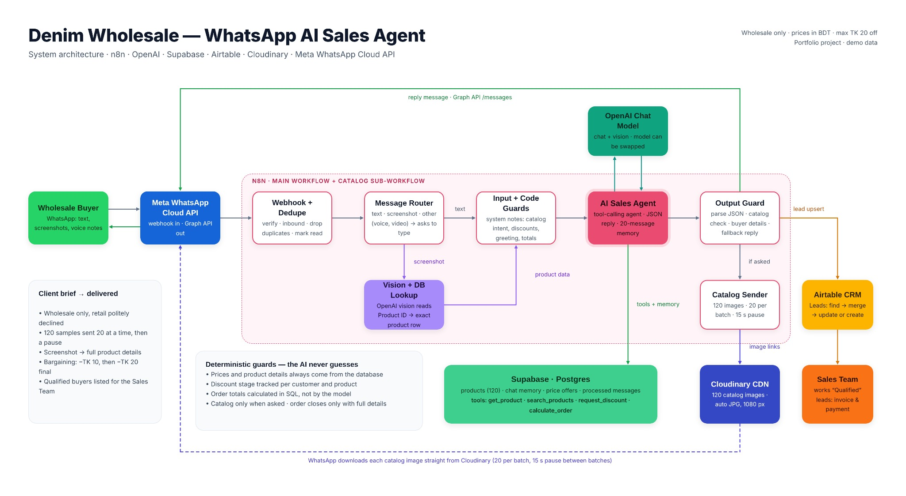

**Flow:** Wholesale buyer → Meta WhatsApp Cloud API → n8n webhook and dedupe → text/vision routing → AI Agent + Supabase SQL tools → WhatsApp reply → optional Catalog Sender and Airtable Sales CRM.

Two connected workflows: [Main AI Sales Agent](workflows/denim-whatsapp-ai-sales-agent.sanitized.json) (39 functional nodes + 5 notes) and [Catalog Sender](workflows/denim-catalog-sender.sanitized.json) (8 functional nodes + 1 note). For detailed routing and design decisions, see [ARCHITECTURE.md](docs/ARCHITECTURE.md).

## Project links

- 🎬 **Final demo video:** [Watch the end-to-end WhatsApp test](https://drive.google.com/file/d/1_yWxXDk5LtWC9U1KoM8k6y3AByp9fHqk/view?usp=sharing)
- 📁 **Full project folder:** [Google Drive project assets](https://drive.google.com/drive/folders/1oh_sF_jLUmoLzIdRB8S52jk_FJ6u9cOX?usp=sharing)
- 🖼️ **Full demo product catalog:** [120 product images](https://drive.google.com/drive/folders/1S5Vb0fs96AMKw8cbrHyNAwEg1V0vEvHJ?usp=sharing)
- 📊 **Airtable CRM:** [Read-only shared Leads view](https://airtable.com/appaQDgOQdg9xNqoz/shrPiGrpdq9VRPKFF/tblH2SXlfPpWyAkht/viwd9bEV105HkNaZy)

> External links and live services are owned by their respective platforms and may require suitable sharing permissions. No credentials are included in this public repository.

## Problem and goal

Denim manufacturers and wholesalers spend significant time answering repetitive WhatsApp questions: *What designs are available? Can you send pictures? What's the price of this pair? Is a further discount possible?* The goal was to automate the **early sales conversation** while keeping pricing, bargaining, and order totals verifiable, then hand an organized list of qualified leads to a human Sales Team.

## Original client requirements — covered

| Requirement | What was implemented |
| --- | --- |
| Wholesale only; politely decline retail | One-bundle minimum per design; retail requests politely rejected and labeled `Retail-Declined` |
| Send about 120 photos, 20 at a time with pauses | Separate n8n Catalog Sender; 20 images/batch with a 15-second pause; images from Cloudinary |
| Recognize buyer's screenshot and give details | OpenAI Vision extracts the printed Product ID; Supabase supplies the correct price, size, bundle, stock and other fields |
| Bargain but discount no more than TK 20/item | DB-controlled `request_discount`: TK 10 first, TK 20 second, final price never decreases further |
| List confirmed wholesale prospects for human follow-up | Airtable Sales CRM captures customer, business, requested products, order amount, status and score |

See the [complete requirements/evidence matrix](docs/FEATURES.md).

## Bonus features built beyond the original brief

Beyond the requested sales flow, the implementation includes:

- **Selective catalog and search:** four product segments and natural-language searches by segment, style, color, fit and budget; only sends photos on explicit request.
- **Exact calculations:** the `calculate_order` SQL tool returns correct piece quantities, bundle quantities, individual lines and grand totals using the buyer's agreed prices.
- **Lead intelligence:** validates seven required customer fields; assigns 1–5 scores, updates statuses, merges cumulative product interests, and prevents downgrading qualified leads.
- **Human handover:** handles requests for a sales representative while collecting the right follow-up data.
- **State and reliability:** 20-message Supabase chat memory per buyer, duplicate webhook protection, read receipts and typing indicators, and graceful fallback replies.
- **Natural conversation control:** short greetings, business-policy answers, polite rejection of unsupported voice/media types, and 24/7 assistant responses.

Every feature is explained in [**Bonus Features & Requirements**](docs/FEATURES.md), with implementation decisions in [IMPLEMENTATION_NOTES.md](docs/IMPLEMENTATION_NOTES.md).

## How the agent works

1. A WhatsApp buyer sends a greeting, catalog request, product question or screenshot.
2. The Meta webhook reaches n8n; the workflow filters status events and duplicate message IDs.
3. Text goes through input guards. Screenshots are analyzed for a Product ID and checked against Supabase. Other media receives a typed-message request.
4. GPT-4o-mini responds through the AI Agent, supported by SQL-based tools for product lookup/search, discount tracking and order calculation.
5. The output guard checks the model's JSON reply, catalog intent and buyer-detail completeness; WhatsApp receives the response.
6. If pictures were requested, the Catalog Sender sends all or just a selected segment in batches.
7. Airtable finds and updates or creates a lead. Once all seven required details and a confirmed order are available, status becomes **Qualified – Ready for Sales** for human follow-up.

## AI tools & deterministic rules

| SQL tool | Purpose |
| --- | --- |
| `get_product` | Fetches actual product information by Product ID |
| `search_products` | Filters up to 15 available products by category, keyword or budget |
| `request_discount` | Persists per-customer/product bargaining stages; TK 10 → TK 20 final |
| `calculate_order` | Calculates accurate per-line and overall order totals from SQL |

**Design principle:** The AI handles conversation and tool selection, but **product details, discount floors and financial totals are database-controlled**, not invented by the language model.

## Tech stack

| Tool | Implementation role |
| --- | --- |
| n8n (self-hosted) | Webhook automation, routing, agent, tools and API actions |
| Meta WhatsApp Cloud API | WhatsApp inbound messages, outbound replies/catalog, read/typing events |
| OpenAI GPT-4o-mini | Conversation, tool-calling and Product ID image recognition |
| Supabase PostgreSQL | Demo catalog, conversation memory, duplicate detection and price-offer stages |
| Airtable | Lead tracking and qualified sales follow-up CRM |
| Cloudinary | Hosts/optimizes demo catalog images |

## Test evidence — original sequence

The 11 original numbered screenshots are retained to show the observed test flow and the supporting implementation.

### Customer conversation (01–05)

**01 — Greeting, categories and retail decline:**

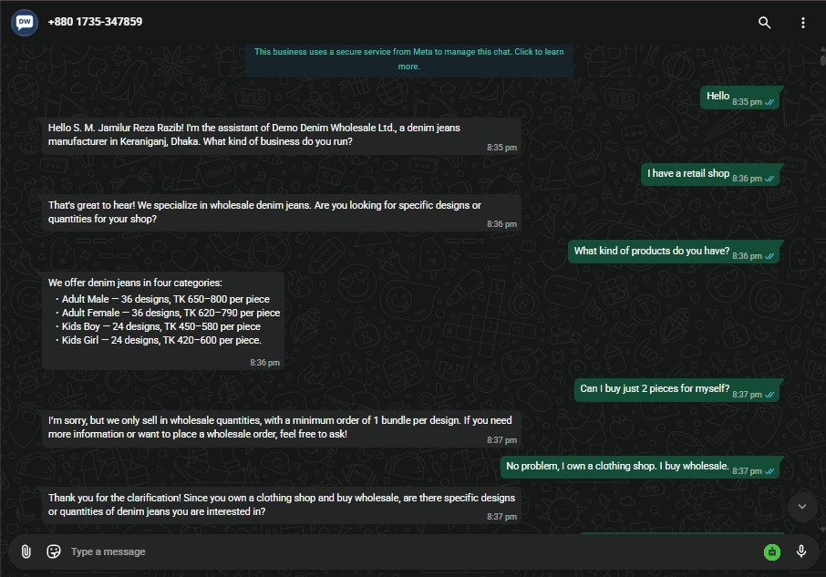

**02 — Explicit catalog request → images in batches:**

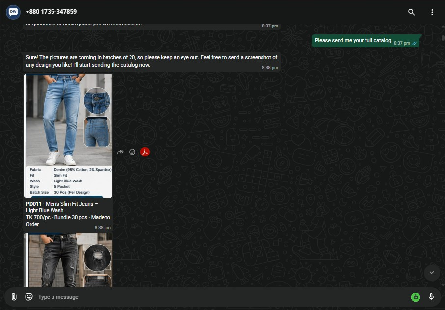

**03 — Buyer screenshot → database-backed product details:**

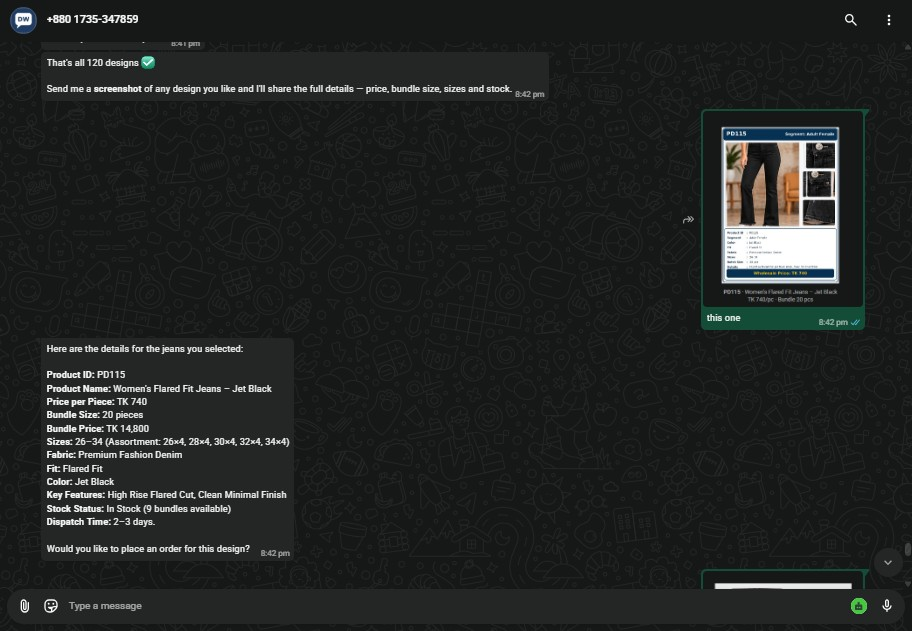

**04 — Two-stage bargaining, final price and lower offer refused:**

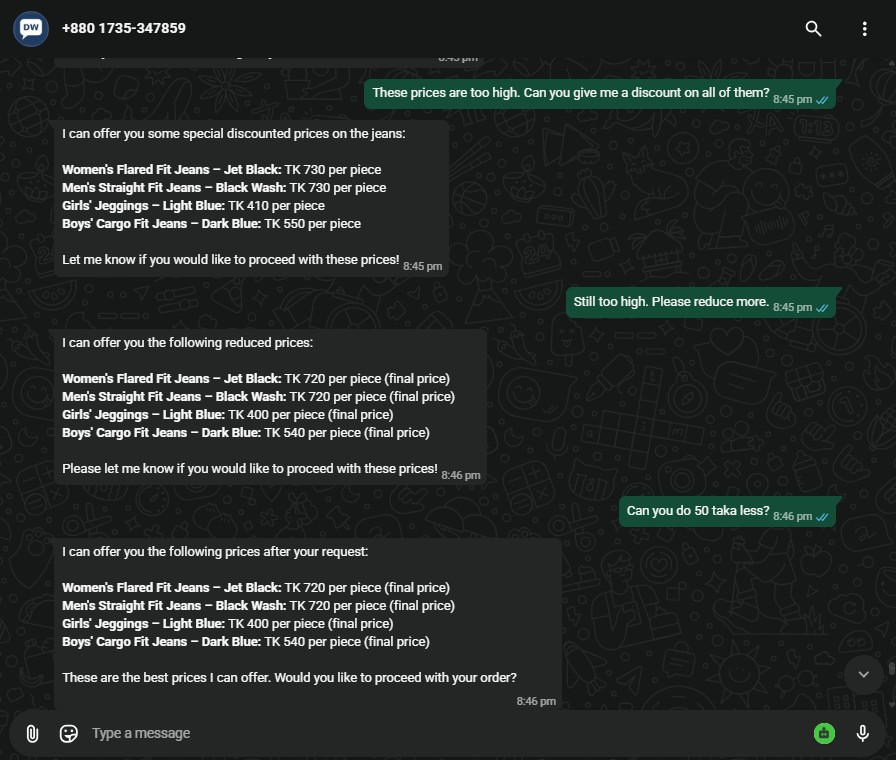

**05 — Exact order total and buyer qualification:**

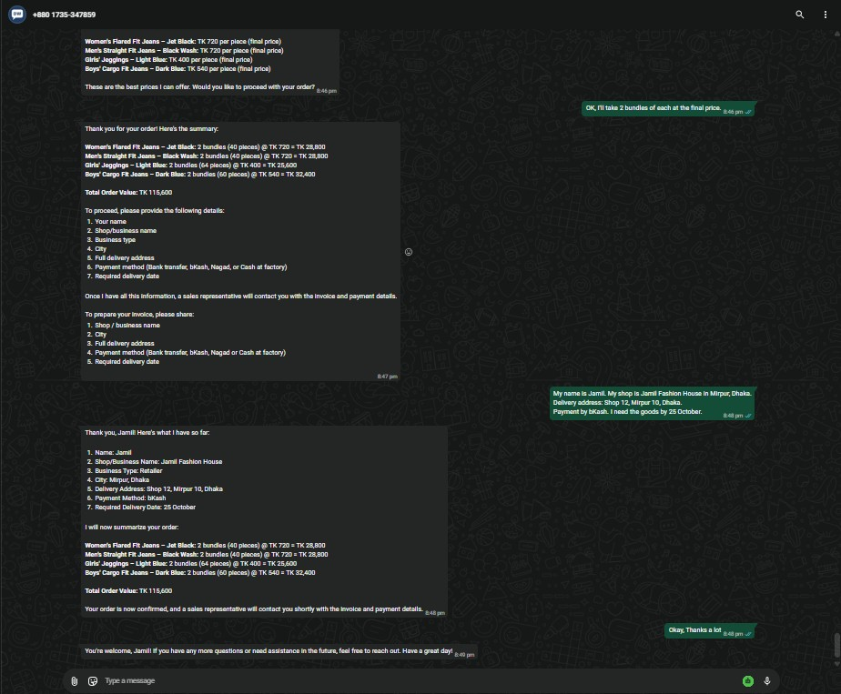

> **Evidence note:** Screenshot 05 shows a repeated buyer-details request. The source README documents that this was identified and corrected after the recorded test. The screenshot is deliberately preserved unchanged; see [TEST_RESULTS.md](docs/TEST_RESULTS.md).

### Workflows and backend (06–11)

**06 — Main n8n WhatsApp AI Sales Agent:**

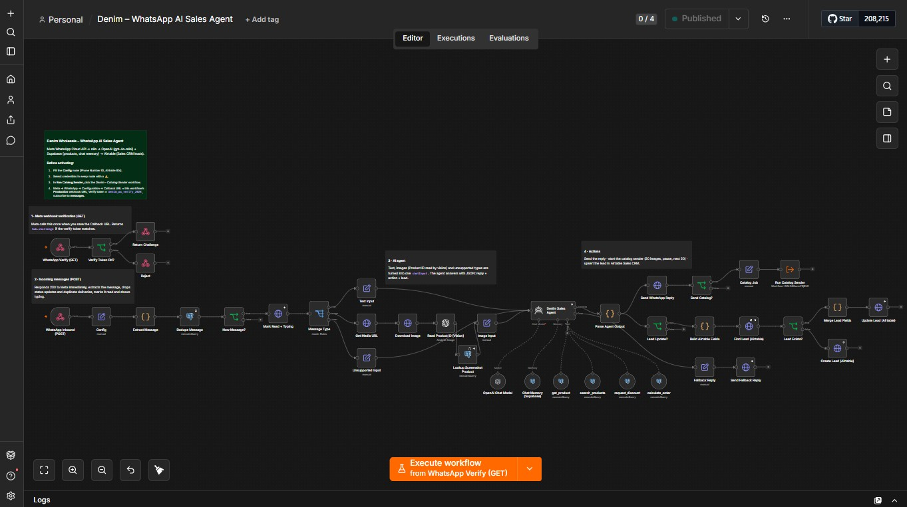

**07 — n8n Catalog Sender:**

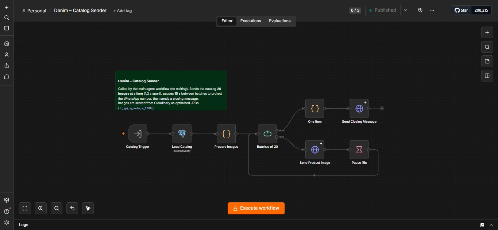

**08 — Supabase database tables:**

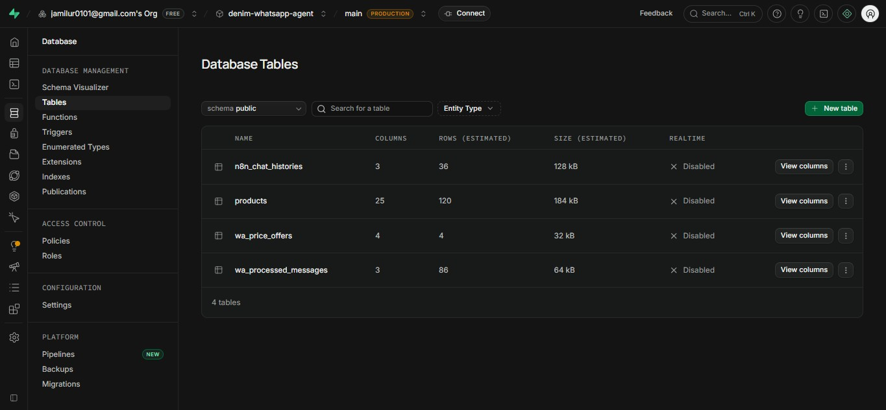

**09 — Supabase demo products (120 rows):**

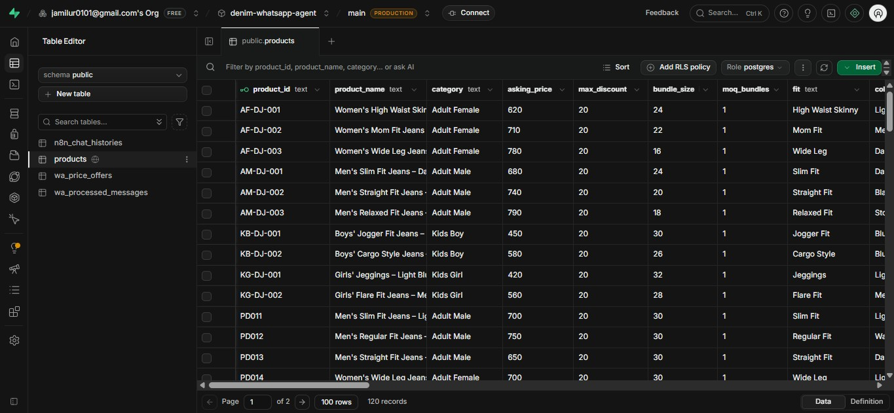

**10 — SQL discount-tracking stages for four tested designs:**

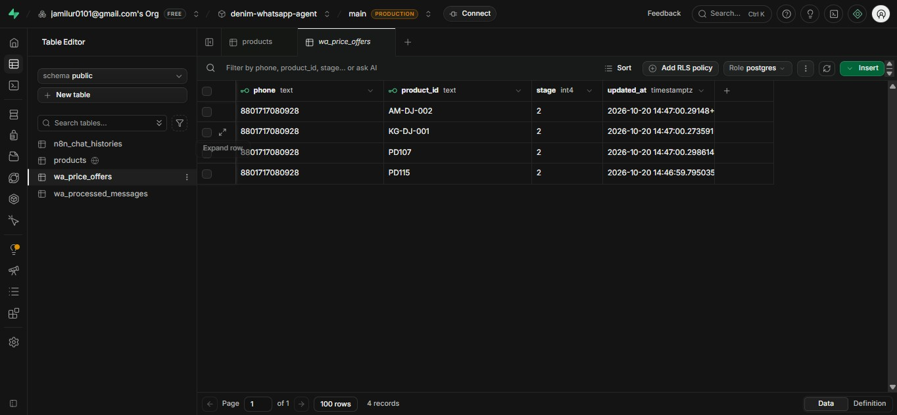

**11 — Cloudinary demo catalog assets:**

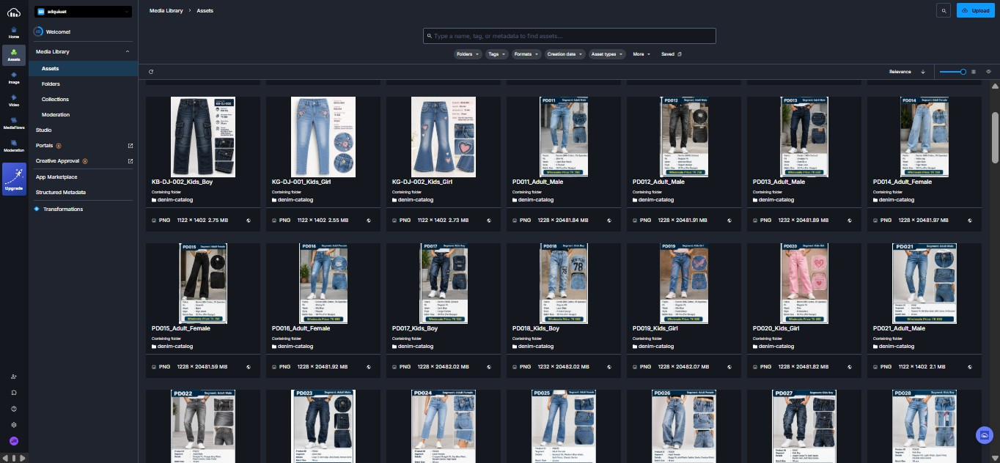

Read the complete [**test results, limitations and fixes**](docs/TEST_RESULTS.md).

## Final test — verified outputs

The buyer tested **four products (PD115, AM-DJ-002, KG-DJ-001, PD107)**, received two reduction rounds, accepted the SQL-calculated **final prices**, and ordered two bundles of each. The recorded result was **8 bundles, TK 115,600**. The associated demo Airtable lead was `Qualified – Ready for Sales` with score **5**. View the [sanitized lead record](data/sanitized-lead-example.csv) and [recorded demo](https://drive.google.com/file/d/1_yWxXDk5LtWC9U1KoM8k6y3AByp9fHqk/view?usp=sharing).

## Representative sample catalog (8 of 120 images)

The project uses **120 generated demo product cards** because real manufacturer's photos were not supplied. Four samples below match the four designs shown in the final test; four additional cards illustrate catalog variation. The full collection is [on Google Drive](https://drive.google.com/drive/folders/1S5Vb0fs96AMKw8cbrHyNAwEg1V0vEvHJ?usp=sharing).

| Final test card | Segment | Additional card |
| --- | --- | --- |
| [PD115](sample-product-images/PD115_Adult_Female.png) | Adult Female | [AF-DJ-001](sample-product-images/AF-DJ-001_Adult_Female.png) |
| [AM-DJ-002](sample-product-images/AM-DJ-002_Adult_Male.png) | Adult Male | [PD011](sample-product-images/PD011_Adult_Male.png) |
| [KG-DJ-001](sample-product-images/KG-DJ-001_Kids_Girl.png) | Kids Girl | [PD020](sample-product-images/PD020_Kids_Girl.png) |
| [PD107](sample-product-images/PD107_Kids_Boy.png) | Kids Boy | [KB-DJ-002](sample-product-images/KB-DJ-002_Kids_Boy.png) |

| PD115 · Adult Female | AM-DJ-002 · Adult Male | KG-DJ-001 · Kids Girl | PD107 · Kids Boy |
| --- | --- | --- | --- |
| 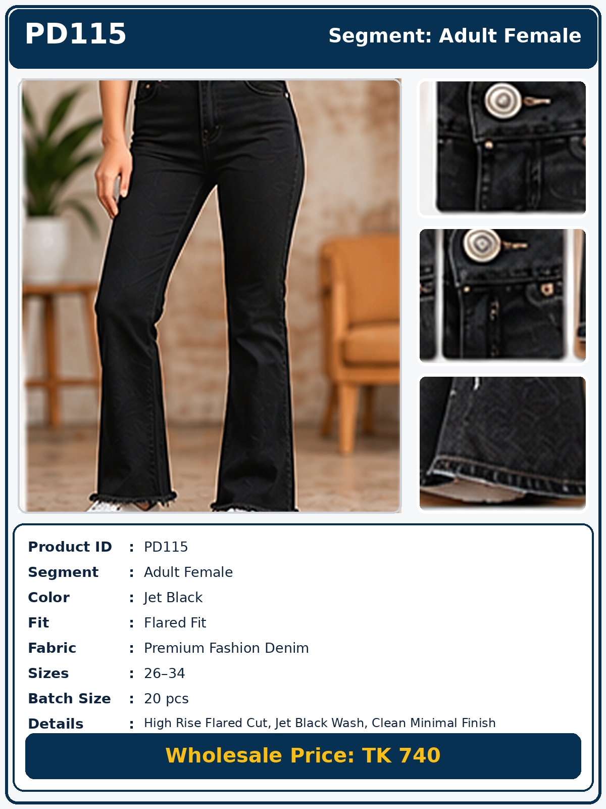 | 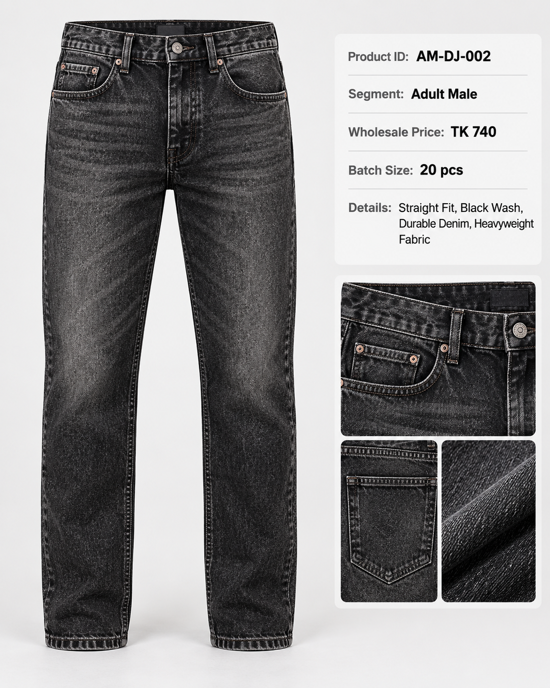 | 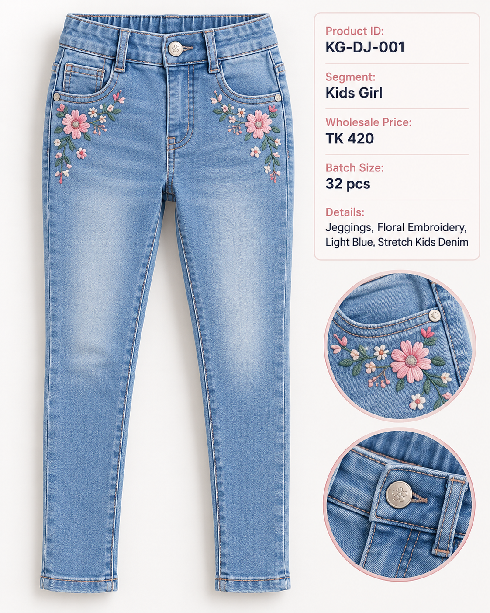 | 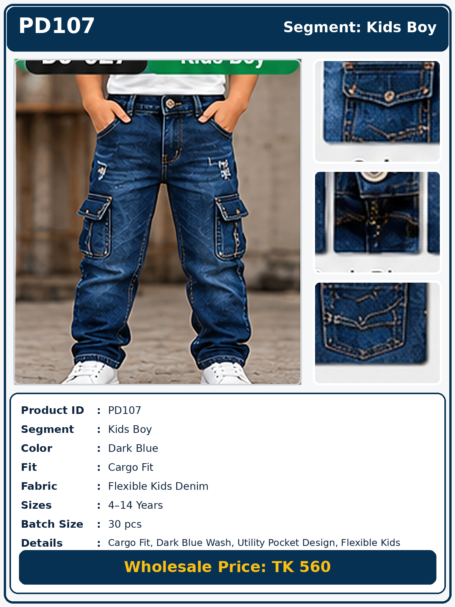 |

## Repository structure

```text
denim-whatsapp-ai-agent-n8n/
├── README.md
├── docs/
│   ├── architecture-diagram.jpg
│   ├── ARCHITECTURE.md
│   ├── FEATURES.md
│   ├── DEMO.md
│   ├── IMPLEMENTATION_NOTES.md
│   ├── SETUP.md
│   ├── TEST_RESULTS.md
│   └── SECURITY.md
├── workflows/
│   ├── denim-whatsapp-ai-sales-agent.sanitized.json
│   └── denim-catalog-sender.sanitized.json
├── database/
│   ├── 01_products_setup.sql
│   ├── 03_agent_tables.sql
│   ├── 04_price_offers.sql
│   ├── legacy/02_auto_prices.sql
│   └── testing/
│       ├── 05_check_price_offers.sql
│       └── 06_reset_test_customer.sql
├── screenshots/
│   └── 01–11 (original named JPEG evidence)
├── sample-product-images/
│   └── 8 representative PNG product cards
└── data/
    ├── Denim_Wholesale_Agent_Data.xlsx
    └── sanitized-lead-example.csv
```

## Setup and reproducing

1. Read [SETUP.md](docs/SETUP.md) and create your own Supabase, Airtable, OpenAI, Cloudinary, Meta WhatsApp and n8n configuration.
2. Execute the fresh-schema SQL files. The legacy price calculation script is **not** required for fresh setup.
3. Import both **sanitized** n8n workflows, connect private credentials and configure IDs and a private verify token.
4. In the main workflow, choose the imported **Denim – Catalog Sender** in its `Run Catalog Sender` node (the export leaves this reference unset).
5. Register a production WhatsApp webhook, publish/activate both n8n workflows and run the test scenarios.

No phone-number ownership, cloud credentials or production service is included in this repository. Setup requires your own accounts and compliance with WhatsApp platform policies.

## Limitations and future improvements

- The human Sales Team is **not automatically notified** on new qualified leads; they view the CRM (a dedicated notification is future work).
- Business-initiated follow-ups after the WhatsApp customer-service window require approved templates; not implemented.
- Filtered-search results are provided as text; sending only matching product images is future work.
- English-only replies; voice transcription and Bangla support are not yet implemented.
- Invoice PDFs, payment links and post-order stock updates are potential next steps, not current features.
- Real manufacturing/retail deployment would require actual product inventory, images, stock/price validation, operational monitoring and business approvals.

See [IMPLEMENTATION_NOTES.md](docs/IMPLEMENTATION_NOTES.md) and [SECURITY.md](docs/SECURITY.md).

## What this project demonstrates

Implementing real-world sales requirements through two connected n8n workflows; protecting operational rules from AI hallucinations through deterministic SQL/tool and code guards; handling screenshot recognition, high-volume catalog delivery, customer-specific bargaining, order validation, lead tracking, and testing/debugging recorded outcomes.

## Author

**S. M. Jamilur Reza Razib** — AI Automation Engineer | AI Agent Builder

- [GitHub](https://github.com/jamilur0101)
- [LinkedIn](https://www.linkedin.com/in/s-m-jamilur-reza-razib)
- [Portfolio](https://automation-ai-jamil.lovable.app/)
